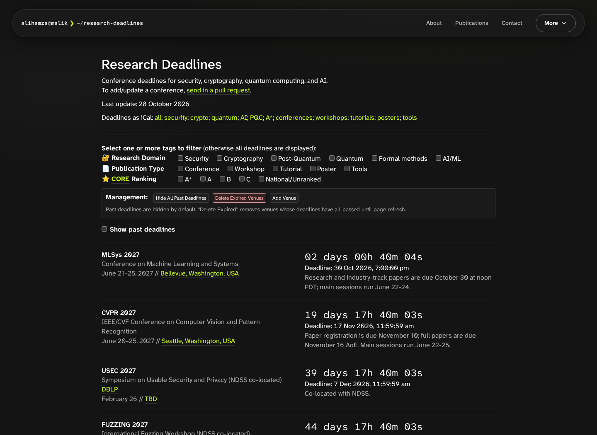
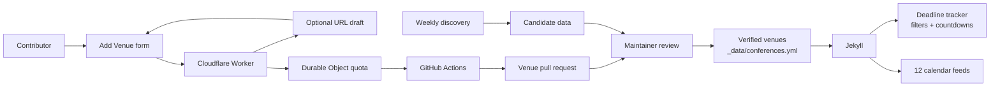

<div align="center">

# Research Deadlines

**Find your next research deadline. Keep it in your local time.**

Conference and workshop countdowns for security, cryptography, quantum computing, post-quantum cryptography, formal methods, and AI.

[**Open the tracker →**](https://alihamzamalik.me/research-deadlines/) · [Subscribe to the calendar](https://alihamzamalik.me/research-deadlines/ical/deadlines-all.ical) · [Contribute a venue](CONTRIBUTING.md)

[](https://github.com/alirafiqmalik/research-deadlines/actions/workflows/venue-tests.yml)
[](https://jekyllrb.com/)
[](backend/src/worker.js)

</div>

[](https://alihamzamalik.me/research-deadlines/)

*Actual interface rendered from this repository. Dates and countdowns change over time.*

## Built for research planning

| Capability | What you can do | Implementation |
| --- | --- | --- |
| Local-time countdowns | See upcoming submission rounds in your timezone; reveal past deadlines when needed. | [Countdown logic](static/js/main.js) |
| Focused browsing | Combine topic, venue type, and ranking filters. | [Filter definitions](_data/filters.yml) |
| Calendar subscriptions | Follow all deadlines or one of 11 topic/type feeds. | [iCalendar templates](ical/) |
| Community submissions | Enter a venue manually or draft it from a public call-for-papers URL, then review the details. | [Submission form](_includes/add-venue.html) |
| Reviewed updates | Proposed venues become pull requests before they appear on the tracker. | [Submission workflow](.github/workflows/venue-submission.yml) |
| Scheduled discovery | Collect candidate venues for review and prune entries older than 90 days. | [Discovery script](scripts/auto_find.py) |

Unannounced deadlines appear as **TBA** and are omitted from calendar events. Always confirm dates against the linked organizer page before submitting a paper.

## How it works



Jekyll builds the tracker and calendars from the same verified venue file. The browser handles filtering and countdowns. The optional submission service validates venue details, checks bot verification, enforces shared daily limits, and requests a reviewable pull request. See the [submission guide](docs/venue-submissions.md) for the complete request flow.

## Run locally

Prerequisites: **Ruby with Jekyll 4.4.1**, **Python 3.12+**, and **Node.js 24+** for the submission service and browser checks.

```sh
git clone https://github.com/alirafiqmalik/research-deadlines.git
cd research-deadlines
gem install jekyll -v 4.4.1 --no-document
python3 -m pip install -r scripts/requirements-venue.txt
make preview
```

Open **http://127.0.0.1:48763/research-deadlines/**. The preview builds into a temporary directory and serves the configured project path. Browsing deadlines needs no backend deployment; submitting venues requires the configured service.

```sh
npm ci --prefix backend
make test                 # Python validation + Worker tests
make check                # Build the Worker deployment bundle without deploying
cd backend
npx --no-install playwright install chromium
npm run test:ui            # Browser checks start their own Jekyll preview
```

Browser checks use service stubs; they do not create real venue submissions. Stop any existing preview before running them because they share port 48763.

## A venue is a YAML record

This example is taken from [`_data/conferences.yml`](_data/conferences.yml); optional descriptive fields are omitted here.

```yaml
- name: MLSys
  year: 2027
  link: https://mlsys.org/Conferences/2027
  deadline:
    - 2026-10-30 12:00
  timezone: America/Los_Angeles
  date: June 21-25, 2027
  place: Bellevue, Washington, USA
  tags: [AI, CONF]
```

Use a list for deadlines, including a single round. Provide an explicit timezone; use `Etc/GMT+12` for Anywhere on Earth. See [the data reference](docs/data-format.md) for required fields, deadline formats, tags, timezone conventions, and legacy rendering behavior.

## Repository map

```text
_data/              Verified venues, discovery candidates, filter definitions
_includes/          Navigation, submission dialog, analytics
_layouts/           Inherited Jekyll layouts
static/             Browser JavaScript, styles, fonts, favicon
ical/               Calendar templates generated by Jekyll
backend/            Cloudflare Worker, runtime configuration, Worker/UI tests
scripts/            Discovery, venue validation, PR processing, preview
tests/              Python validation and submission workflow tests
docs/               Data reference, operations guides, interface captures
.github/workflows/  Discovery, submission processing, safety checks, CI
index.html          Main Jekyll page
_config.yml         Site identity, project path, submission endpoint
Makefile            Preview, build, and verification commands
```

Jekyll's conventional directories stay at the root so GitHub Pages can build the site directly. Operational documentation and developer tooling are excluded from the published site.

## Contribute and maintain

- **Add or correct a venue:** use **Add Venue** in the tracker or follow [CONTRIBUTING.md](CONTRIBUTING.md).
- **Understand the data:** [venue schema and timezone reference](docs/data-format.md).
- **Operate the service:** [submission setup and verification](docs/venue-submissions.md).
- **Understand scheduled changes:** [automation guide](docs/automation.md).
- **Report a bug:** [open an issue](https://github.com/alirafiqmalik/research-deadlines/issues/new) with steps to reproduce and the affected venue or browser.

Previously published as `sec-deadlines`. Update website bookmarks and calendar subscriptions to `/research-deadlines/`; GitHub repository redirects do not redirect the old project website path. The deployed submission service retains its existing hostname to keep the public API endpoint stable.

## Credits

Maintained by [Ali Hamza Malik](https://alihamzamalik.me/). Built on [sec-deadlines](https://github.com/sec-deadlines/sec-deadlines.github.io) and [ai-deadlines](https://github.com/ai-deadlines/ai-deadlines), originally created by [Abhishek Das](https://github.com/abshkdz). The bundled Atkinson Hyperlegible fonts include their [OFL notice](static/fonts/OFL.txt).
